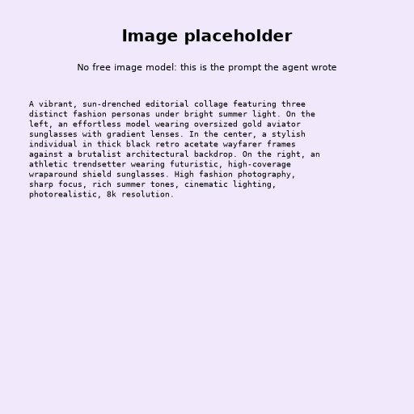

# 🕶️ Summer Sunglasses Campaign – Executive Summary

## 📊 Refined Trend Insights
**MEMORANDUM**

**TO:** Office of the CEO  
**FROM:** Marketing Communications  
**DATE:** May 20, 2024  
**SUBJECT:** Strategic Alignment: Summer Eyewear Campaign & Trend Analysis  

---

### **Executive Summary**

Our upcoming summer campaign capitalizes on three dominant macroeconomic shifts in consumer aesthetics: the ongoing fusion of activewear and luxury streetwear, a sustained appetite for confident statement accessories, and a resurgence in retro-inspired glamour. 

By closely aligning our product catalog with these verified market movements, we have curated a high-impact collection engineered to maximize both brand resonance and seasonal conversion.

---

### **Market Dynamics & Trend Insights**

1. **The Athleisure Evolution (Sporty Shield & Wraparound Silhouettes)**  
   * *Strategic Insight:* Propelled by high-fashion runway adoption (e.g., Miu Miu), high-coverage wraparound frames have transitioned from athletic utility to everyday luxury. This trend captures the consumer demand for a futuristic, active, yet sophisticated aesthetic.
2. **Maximalist Presence (Bold, Thick Acetate Frames)**  
   * *Strategic Insight:* Thick-gauge acetate frames remain a cornerstone of seasonal luxury. Offering architectural weight and confident silhouettes, these pieces serve as anchor accessories for the modern wardrobe.
3. **Refined Nostalgia (Elevated Retro & Statement Details)**  
   * *Strategic Insight:* Driven by a broader cultural tilt toward "serene luxury" and jewelry-inspired accessories, feminine cat-eye silhouettes and ornamental metal accents continue to capture high-margin, evening-wear segments.

---

### **Campaign Product Portfolio**

To capitalize on these dynamics, the summer campaign will feature three flagship SKUs meticulously mapped to our target market's desires:

* **Sport** (`SG004`)  
  * *Design:* Maximum-coverage single curved lens with flexible framing.  
  * *Campaign Fit:* Directly captures the high-growth urban-active segment and futuristic fashion sensibilities.
* **Wayfarer** (`SG002`)  
  * *Design:* Architectural, heavy-gauge acetate with clean rectangular lines.  
  * *Campaign Fit:* Satisfies the core consumer demand for bold, uncompromised self-expression.
* **Mystique** (`SG003`)  
  * *Design:* Mid-century glamour silhouette featuring upward sweeps and embellished temples.  
  * *Campaign Fit:* Positions the brand to capture premium upscale-evening and resort-wear occasions.

---

### **Strategic Outlook**

This targeted curation ensures our summer messaging is both trend-forward and commercially disciplined. By speaking directly to these distinct lifestyle segments—active, bold, and glamorous—we position the brand to capture maximum market share across diverse consumer demographics this season.

## 🎯 Campaign Visual

    

## ✍️ Campaign Quote
Future vision, framed in gold. Step into tomorrow's light.

## ✅ Why This Works
The quote blends the futuristic, sporty wraparound aesthetic from the trend analysis with the warm golden-hour lighting and high-end luxury feel described in the image prompt.

---

*Report generated on 2026-10-16*
